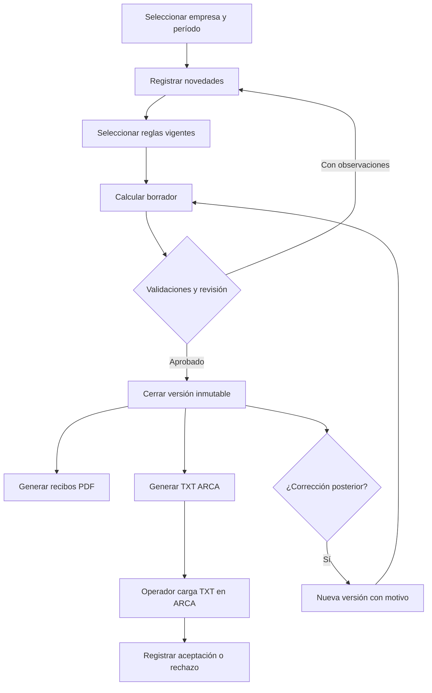

# Especificación de Requisitos de Software (SRS)
## Plataforma web de liquidación de sueldos para estudio contable

**Versión:** 0.2 — alternativas de stack ampliadas, NO aprobado para producción  
**Fecha:** 09/10/2026  
**Estado:** Requisitos iniciales documentados; decisiones pendientes identificadas  
**Idioma de aplicación:** español (Argentina)  
**Destinatarios:** propietario del proyecto, responsables del estudio contable, desarrolladores y agentes de programación (Codex, Claude Code, Antigravity).

> **Regla fundamental:** no interpretar este documento como autorización para crear un sistema de liquidaciones listo para operar sin validación funcional, legal, técnica y pruebas con ARCA. Los ejemplos originales sirven para entender el sistema existente; no se los debe asumir normativamente correctos.

---

## 1. Propósito y alcance

### 1.1 Objetivo
Construir una aplicación web nueva, de uso exclusivamente interno por el estudio contable, para administrar empleadores, legajos, convenios, escalas salariales, novedades y liquidaciones de haberes, generar recibos PDF e intercambiar archivos **TXT compatibles con Libro de Sueldos Digital (LSD) de ARCA** mediante carga **manual por el personal del estudio**.

### 1.2 Contexto operativo confirmado
- Aproximadamente **80–100 empresas** empleadoras; cantidad máxima de trabajadores por empresa **a confirmar**.
- Unas **5 personas trabajando de forma simultánea**, desde **dos oficinas**.
- Una **base de datos centralizada** y coherente: no dos servidores de liquidación independientes.
- Cada operador tendrá un usuario individual. Se debe identificar quién crea, modifica, revisa, aprueba y exporta cada liquidación.
- Alojamiento previsto: cuenta **Hostinger Business Web Hosting** ya contratada. Deben evaluarse **PHP/Laravel** y **Next.js/Node.js** como alternativas antes de elegir la tecnología; verificar recursos reales del plan y efectuar pruebas de despliegue para ambas.
- Acceso exclusivo a empleados autorizados del estudio; las empresas clientes **no** tendrán portal de acceso en el alcance actual.
- Importación directa a ARCA, comunicación API, envío automático de trámites o altas/bajas oficiales: **fuera de alcance**. La integración con ARCA se limita a generar un archivo que operadores descargarán y subirán manualmente.
- Diseño visual **original**, sin copiar pantallas, íconos, disposición ni identidad gráfica del sistema existente.

### 1.3 Objetivos medibles
1. Liquidar sueldos de empresas diferentes sin mezclar sus datos.
2. Soportar todos los tipos de liquidación requeridos, según fases y validaciones.
3. Volver a abrir históricos y corregirlos **sin borrar el estado original**.
4. Generar recibos PDF correctos y legibles para entregar a clientes.
5. Generar TXT según el **diseño vigente** de ARCA y validar su estructura antes de descargar.
6. Permitir trabajo simultáneo, permisos, auditoría, copias de seguridad y restauración verificable.

### 1.4 Exclusiones explícitas
- No automatizar ingreso al sitio de ARCA ni pedir credenciales fiscales.
- No enviar pagos ni transferencias bancarias desde la aplicación.
- No enviar correos ni WhatsApp a empleados/clientes automáticamente en la primera versión.
- No construir funciones de liquidación sobre reglas laborales inventadas.
- No copiar código fuente, base de código, esquema propietario ni interfaz protegida del producto de referencia. Importar **datos propios del estudio** es una necesidad funcional separada y su viabilidad deberá verificarse.
- No asumir que un PDF de referencia representa el tratamiento legal correcto de cada concepto.

---

## 2. Partes interesadas y perfiles

| Perfil | Objetivo | Permisos recomendados |
|---|---|---|
| Administrador técnico | Configurar usuarios, permisos, respaldos, integraciones | Administración técnica; no implica aprobación laboral automática |
| Administrador funcional | Configurar empresas, convenios, conceptos, parámetros, escalas | Crear y versionar parámetros, con registro de cambios |
| Liquidador | Registrar novedades, crear borradores y calcular | Trabajar en empresas autorizadas; no alterar versiones publicadas |
| Revisor / aprobador | Controlar cálculos, aprobar y cerrar liquidaciones | Autorizar publicación, corrección y exportación |
| Auditor / consulta | Ver historial, comparaciones y reportes | Lectura, sin edición |

Un usuario puede tener varios roles; todos los permisos deberán comprobarse **en servidor** y, cuando corresponda, por empresa. Para un estudio pequeño, algunos roles pueden recaer en la misma persona, pero el sistema debe conservar quién realizó cada acción.

---

## 3. Modelo conceptual de negocio

- **Estudio**: entidad operadora del sistema.
- **Empleador / empresa cliente**: razón social, CUIT, domicilios, parámetros de empleador y condiciones previsionales, uno o más establecimientos.
- **Establecimiento / lugar de pago**: localidades y centros informativos asociados al empleador, con su propia codificación cuando corresponda.
- **Trabajador**: datos personales mínimos, CUIL, vínculos laborales y estado registral interno.
- **Relación laboral / legajo**: empresa, legajo, fecha de ingreso, fecha de antigüedad reconocida (independiente), categoría, convenio, puesto, modalidad, jornada, obra social, alta/baja internas, remuneración pactada y períodos de vigencia.
- **Convenio (CCT)**: identificación y versión de reglas; puede existir convenio principal y condiciones particulares por empresa/trabajador.
- **Categoría / escalafón**: pertenencia a convenio y escalas de valores **versionadas por vigencia**.
- **Catálogo de conceptos**: conceptos generales reutilizables, código interno, tipo y atributos; parametrización especial por convenio/empresa/periodo cuando corresponda. No asumir que Cortez maneja códigos globales hasta probarlo.
- **Fórmula / regla**: expresión declarativa versionada con tipos, variables, condicionamientos, orden de cálculo y reglas de redondeo.
- **Novedad**: falta, licencia, enfermedad, vacaciones, horas extra, suspensión, adelanto, retroactivo, altas/bajas internas, etc., con fecha, unidades, justificativo y trazabilidad.
- **Período**: AAAAMM y su estado por empresa.
- **Liquidación**: evento de sueldos del empleador (mensual, SAC, final, complementaria, etc.), número interno, fecha de pago, días base y trabajadores incluidos.
- **Resultado por trabajador**: detalle de conceptos y bases imponibles, totales, neto, costo patronal y snapshot de parámetros empleados.
- **Versión de liquidación**: revisión inmutable que permite comparar y eventualmente corregir sin reescribir el histórico.
- **Artefacto**: PDF o TXT generado desde una versión concreta, con usuario y fecha, hash, parámetros y estado de aceptación ARCA registrado manualmente.

### 3.1 Hipótesis crítica: conceptos comunes o por convenio
El usuario **cree** que modificar un concepto en el sistema actual puede afectar a todos los convenios, pero **no está confirmado**. El nuevo sistema se diseñará sin esa limitación:
- Un catálogo base común de conceptos para reutilizar descripciones y reglas.
- Una **asignación/versionado por convenio**, cuando el cálculo varíe.
- Una **anulación/sobrescritura controlada por empresa** solo con autorización y vigencia.
- Los recibos y las exportaciones usarán el **snapshot de la regla utilizada** en el momento de su aprobación, no la regla actual.
- Alteraciones de catálogos deberán mostrar a qué empresas y convenios impactarían; no modificar retrospectivamente históricos.

**Decisión por validar:** códigos internos únicos globales o códigos por contexto `(empresa, convenio, código)`. La DB tendrá identificadores técnicos independientes de los códigos visibles, evitando colisiones.

---

## 4. Requisitos funcionales (RF)

Cada requisito se considera obligatorio salvo que diga explícitamente **Fase posterior** o **Pendiente**.

### 4.1 Acceso, seguridad y auditoría

- **RF-001** Autenticación individual por usuario/contraseña con hash seguro; permitir MFA para roles sensibles.
- **RF-002** Roles/permisos diferenciados a nivel de operación y empresa.
- **RF-003** Sesión segura con vencimiento, revocación y protección frente a intentos de acceso no autorizados.
- **RF-004** Registro de auditoría no editable por usuarios comunes: usuario, fecha/hora, empresa, entidad, acción, valores relevantes anteriores/nuevos, motivo y origen.
- **RF-005** Registro independiente de aprobación/cierre/reapertura/publicación/exportación; no confundir creador con aprobador.
- **RF-006** Dos usuarios que editen el mismo recurso deben recibir detección de conflicto mediante control de versión/optimistic locking. Nunca sobrescribir silenciosamente.
- **RF-007** Posibilidad de limitar acceso por oficinas solo si el estudio lo solicita. Ambas oficinas verán la información unificada según roles.

### 4.2 Empresas y configuración

- **RF-010** Alta, edición, inactivación y búsqueda de empleadores, con validación de CUIT y prevención de duplicados.
- **RF-011** Configurar datos fiscales/laborales, establecimientos, ART, obra social y parámetros de liquidación específicos del empleador.
- **RF-012** Mantener catálogos de localidades/lugares de pago, obras sociales y otros códigos requeridos; conservar códigos con cero inicial y vigencias.
- **RF-013** Configurar permisos de usuarios por empresa.
- **RF-014** Mostrar dashboard por período: empresas pendientes, en preparación, para revisar, aprobadas y exportadas.
- **RF-015** Habilitar parámetros por período con valores históricos y fechas de vigencia; publicar cambios mediante revisión.

### 4.3 Convenios, escalas, categorías y conceptos

- **RF-020** Catálogo multiconvenio: número CCT, nombre, estado, vigencia y notas.
- **RF-021** Categorías y escalafones asociados a convenios y aplicabilidad territorial/condiciones, a confirmar por análisis.
- **RF-022** Importar/cargar escalas salariales por rango de vigencia, tipo de jornada y categoría; no reemplazar meses anteriores.
- **RF-023** Conceptos con código visible, descripción, naturaleza (remunerativo/no remunerativo/descuento/indemnizatorio/etc.), unidad, posición en recibo, afectación de bases y reglas de exportación.
- **RF-024** Editor de fórmulas **declarativo** y seguro, con variables tipadas, referencias a otros conceptos y expresiones condicionales autorizadas, sin `eval` ni código arbitrario.
- **RF-025** Validar referencias existentes, divisiones por cero, dependencias circulares y compatibilidad de tipos antes de activar una fórmula.
- **RF-026** Vista previa de fórmula con datos sintéticos y explicación desglosada de cálculo.
- **RF-027** Versiones de fórmulas, escalas y parámetros por vigencia; nunca alterar resultados aprobados.
- **RF-028** Posibilidad de conceptos globales con reglas específicas de convenio/empresa; cambios con análisis de impacto.
- **RF-029** Parametrización de correspondencia con códigos oficiales de ARCA **por empleador**, según requerimientos de LSD, con vigencias y validaciones.
- **RF-030** Registrar altas, cambios y aprobación de reglas; rechazo de modificaciones peligrosas sin revisión.

### 4.4 Legajos y novedades

- **RF-040** Legajo por empresa: CUIL, código de legajo, nombres, fecha de ingreso, fecha de antigüedad reconocida, egreso, convenio/categoría, modalidad, jornada, obra social, CBU opcional, situación de revista y parámetros obligatorios para ARCA.
- **RF-041** Historia temporal de cambios en categoría, jornada, sueldo y obra social.
- **RF-042** Novedades fechadas: asistencia/faltas, enfermedad inculpable, accidente/ART, licencias especiales, maternidad, vacaciones, suspensiones, horas extra, feriados, anticipos, ajustes y otros.
- **RF-043** Alta y baja **internas** y cambio de estado del trabajador; no realizar trámite ante ARCA.
- **RF-044** Novedades recurrentes versus novedades del mes: copiar solo las recurrentes autorizadas.
- **RF-045** Anexar documentos opcionales con acceso restringido, controles de tamaño/tipo, sin incorporar documentación sensible sin necesidad.
- **RF-046** Validar solapamiento de licencias, fechas fuera de relación laboral y períodos cerrados.

### 4.5 Liquidación y cálculo

- **RF-050** Crear liquidaciones mensuales, quincenales, semanales, SAC 1.ª/2.ª cuota, vacaciones, complementarias, retroactivas y finales (despido, renuncia, etc.) con modelos específicos y controles.
- **RF-051** Elegir empresa/período/tipo/número de liquidación/fecha de pago/días base/trabajadores.
- **RF-052** Precargar información de legajos y conceptos usuales desde el período anterior **sin copiar indebidamente novedades temporales**.
- **RF-053** Aplicar reglas vigentes a la fecha/período adecuado; resolver dependencias por orden topológico.
- **RF-054** Calcular haberes remunerativos, no remunerativos, descuentos, indemnizaciones, aportes y contribuciones usando bases independientes y reglas versionadas.
- **RF-055** Calcular importes monetarios con precisión decimal, documentando escala y redondeo por concepto, base y total.
- **RF-056** Cargar valores manuales SOLO en conceptos permitidos, guardando usuario, motivo, referencia y diferencia respecto del cálculo automático.
- **RF-057** Mostrar preliquidación individual y general por empresa con alertas de anomalía.
- **RF-058** Manejar alta, baja y licencia en el período, incluyendo proporcionalizaciones según regla validada.
- **RF-059** Registrar múltiples liquidaciones de un trabajador en el mismo AAAAMM y aplicar acumulaciones exigidas por ARCA al exportar, sin sumar dos veces importes en el recibo.
- **RF-060** Diferenciar salarios/bases según jornada, topes y condiciones específicas. Las reglas fiscales/previsionales requerirán revisión técnica y validación contable.
- **RF-061** Soportar liquidación final con conceptos diferenciados, pero los cálculos de indemnización NO deben codificarse hasta tener casos y reglas legalmente validados.
- **RF-062** Control de estados: `BORRADOR -> CALCULADA -> EN_REVISION -> APROBADA -> CERRADA`; correcciones posteriores por versión nueva, no edición sobre la versión cerrada.
- **RF-063** Informes de costo total del empleador, totales por empresa/período, comparativo intermensual, importe neto por CUIL.
- **RF-064** Detección de diferencias entre liquidaciones de un mismo trabajador y alertas por cambios anómalos, sin alterar el resultado automáticamente.

### 4.6 Históricos, corrección y migración

- **RF-070** Buscar liquidaciones por empresa, mes, año, empleado, tipo de liquidación y estado.
- **RF-071** Ver cualquier liquidación histórica con **su propia versión de fórmulas, escalas, legajos y parámetros**.
- **RF-072** Duplicar liquidación histórica en un **borrador nuevo**, conservando la original.
- **RF-073** Crear corrección de un período cerrado bajo autorización, registrando motivo, versión anterior/nueva, diferencias por concepto, PDF y TXT asociados.
- **RF-074** Marcar si el período fue exportado/presentado a ARCA e impedir tratar una corrección como mero reemplazo sin evaluación de rectificativa.
- **RF-075** Migración histórica de formatos heredados (por ejemplo archivos `.DBF`) solo si se obtiene una **copia autorizada** y documentación/muestra que permita reconocer relaciones entre tablas.
- **RF-076** Importación histórica con previsualización, validaciones, conteos, informes de errores, posibilidad de rollback y registro de procedencia.
- **RF-077** Guardar PDFs/TXTs antiguos como adjuntos históricos si se autoriza y no se puede reconstruir su cálculo exacto; distinguir `IMPORTADO_SIN_RECALCULO` de `CALCULADO_POR_NUEVO_SISTEMA`.

### 4.7 Recibos y archivos de salida

- **RF-080** Recibo PDF individual con identificación de empleador y trabajador, período, legajo, fecha de ingreso/antigüedad, categoría, obra social, conceptos, unidades, importes, totales y neto; información patronal configurable/obligatoria según validación.
- **RF-081** PDF individual, conjunto por empresa y originales/duplicados cuando corresponda. Plantilla original, accesible para impresión A4 y envío electrónico.
- **RF-082** Versionar y registrar PDFs emitidos; emitir nuevo documento al corregir, preservando el anterior y su estado.
- **RF-083** Exportador `.txt` LSD **de ancho fijo**, según diseño oficial ARCA vigente, identificación `SJ` para envío ordinario.
- **RF-084** Soportar registros `01`, `02`, `03`, `04` y opcionales `05`, `06` cuando correspondan y según versión oficial; `RE` para rectificación **solo tras diseño y flujo validados**.
- **RF-085** Validar anchos, posiciones, CUIL/CUIT, formatos numéricos, CRLF/encoding, fechas, unidades, tipos de registros, referencias y datos obligatorios antes de permitir descarga.
- **RF-086** Registro 03: código concepto de empleador y tabla de vinculación vigente con concepto ARCA. No asumir que código local = código ARCA.
- **RF-087** Registro 04: generar perfil y bases imponibles; contemplar regla de acumulación entre liquidaciones del mismo trabajador/período que ARCA determina.
- **RF-088** Log de exportación (empresa, período, número, tipo, versión, usuario, hash, fecha). Permitir indicar manualmente `PENDIENTE/ACEPTADO/RECHAZADO` y documentar error de ARCA.
- **RF-089** No permitir exportar liquidaciones no aprobadas, salvo modo de prueba explícito que no genere un archivo confundible con presentación real.
- **RF-090** Herramienta de diagnóstico de TXT para inspección de registros y posiciones, enmascarando CUIT/CUIL y evitando filtrar información sensible.

### 4.8 Operación y configuraciones

- **RF-100** Consola administrativa para versiones de catálogos, tasas y parámetros, con roles.
- **RF-101** Exportar respaldos de datos del estudio y permitir restauración bajo procedimiento probado (no entregar backups por URL pública).
- **RF-102** Registro de fallos de aplicación sin datos personales ni secretos en logs.
- **RF-103** Búsqueda rápida por empresa, apellido, legajo, CUIL y período.
- **RF-104** Filtrar liquidaciones pendientes por oficina/operador/estado sin fragmentar los datos por sede.

---

## 5. Reglas de negocio que NO deben suponerse

**RN-001** Cada fórmula depende de su definición de variable, tipo, período de vigencia y reglas del convenio/empresa.  
**RN-002** Una fecha de ingreso administrativo y una fecha de antigüedad reconocida pueden ser diferentes.  
**RN-003** La jornada parcial no implica que todas las bases imponibles se reduzcan de modo idéntico; hay ejemplos donde bases de obra social y seguridad social difieren.  
**RN-004** Los códigos y tratamientos de remuneraciones/descuentos ante ARCA requieren parametrización y validación.  
**RN-005** Las sumas no remunerativas pueden integrar distintas bases según normas, convenio, fecha y clase de aporte.  
**RN-006** Un resultado coincidente con un recibo antiguo es una **prueba de regresión**, no prueba de cumplimiento legal actual.  
**RN-007** No actualizar períodos anteriores al cambiar escalas, conceptos ni porcentajes: usar vigencias + snapshots inmutables.  
**RN-008** Corrección de una liquidación presentada: requiere estado y tratamiento especial; puede implicar rectificativa o ajuste, y no basta con reemplazar el TXT.  
**RN-009** El sistema no debe calcular a partir de archivos TXT importados como si fueran fuente principal: el TXT es **salida derivada** de la liquidación validada.  
**RN-010** Todas las operaciones monetarias se expresan con Decimal/NUMERIC, nunca con flotantes JS sin control.

---

## 6. Casos de uso principales

| ID | Caso de uso | Flujo esperado |
|---|---|---|
| UC-01 | Crear empresa | Completar CUIT y parámetros; guardar, auditar, permitir asignación de usuarios |
| UC-02 | Alta legajo interno | Seleccionar empresa, CUIL, fecha ingreso, CCT/categoría/jornada; generar evento |
| UC-03 | Cargar escala | Elegir CCT/categoría, vigencia y importes; simular impacto; aprobar versión |
| UC-04 | Registrar novedad | Elegir empleado y período; tipo/cantidad/días; validar consistencia |
| UC-05 | Liquidar mensual | Crear período, precargar reglas, calcular, revisar, aprobar y cerrar |
| UC-06 | Liquidación final | Seleccionar causal y fecha de egreso, parámetros, liquidar y revisar antes de aprobar |
| UC-07 | Emitir recibos | Generar PDFs desde versión aprobada; registrar documentos emitidos |
| UC-08 | Exportar LSD | Validar mapeo y bases; generar y descargar TXT; registrar versión/hash |
| UC-09 | Corregir histórico | Abrir versión cerrada, crear borrador correctivo, comparar, aprobar y gestionar efectos ARCA |
| UC-10 | Trabajar en paralelo | Detectar conflicto de edición de una empresa/liquidación y resolver sin pérdida silenciosa |
| UC-11 | Investigar error | Consultar auditoría, reglas y entradas que produjeron cada importe |
| UC-12 | Importar DBF | Analizar estructura, mapear, previsualizar y ejecutar migración con rollback |

---

## 7. Requisitos no funcionales (RNF)

- **RNF-001 Disponibilidad:** uso web vía HTTPS desde ambas sedes; disponibilidad objetivo inicial de 99,5 % mensual durante horas de operación, a confirmar con hosting.
- **RNF-002 Capacidad:** 5 sesiones concurrentes reales, pruebas con 100 empresas y **conjunto de trabajadores sintético parametrizable**; el volumen máximo no se conoce aún.
- **RNF-003 Performance:** referencia objetivo en entorno de pruebas: navegación habitual p95 < 2 s; preliquidación de 100 empleados < 30 s (revisable después de medir infraestructura).
- **RNF-004 Seguridad:** TLS; contraseñas hasheadas; autorización en servidor; prevención de XSS/CSRF/SQLi; rate limiting; cookies seguras; MFA al menos para administradores.
- **RNF-005 Privacidad:** información de salarios, CUIL, CBU y domicilios; minimización de datos, acceso por rol y auditoría; prohibido incluirlos en prompts públicos, repositorios, fixtures, logs o capturas sin anonimizar.
- **RNF-006 Integridad:** transacciones DB, claves foráneas, restricciones por compañía, ids internos estables, bloqueo optimista y no reutilización de un identificador ajeno.
- **RNF-007 Backup:** copia cifrada de DB/adjuntos, fuera de la ruta pública, mínimo diaria; restauración de prueba mensual; confirmar retención, RPO y RTO con el estudio.
- **RNF-008 Trazabilidad:** cada versión aprobada reproduce el total aunque se modifiquen posteriormente tablas globales.
- **RNF-009 Mantenibilidad:** tipado estricto y análisis estático según el stack elegido (TypeScript o PHP moderno), migraciones DB versionadas, suite de tests, CI y Git. Evitar dependencia del framework en el motor de fórmulas.
- **RNF-010 Interoperabilidad:** PDF estándar; TXT LSD validado byte a byte; fechas AAAAMM / AAAAMMDD; decimales sin problemas regionales.
- **RNF-011 Usabilidad:** escritorio como prioridad; navegación por teclado, búsqueda veloz, tablas legibles, flujos con confirmaciones explícitas.
- **RNF-012 Observabilidad:** logs estructurados, métricas de errores y respaldos; sin exponer datos personales.
- **RNF-013 Separación:** ambientes local, staging y producción; ningún agente publica ni migra datos reales sin aprobación humana.
- **RNF-014 Aislamiento:** ningún operador ni endpoint debe ver datos de una empresa sin autorización.

---

## 8. Arquitectura inicial propuesta — DECISIÓN PENDIENTE

La aplicación debe implementarse como **monolito modular web**, con motor de liquidación independiente de la UI, base de datos centralizada, PDFs/TXT privados, roles, transacciones, auditoría y versionado histórico. **PHP es una opción de primera clase, no una solución secundaria.** No se decide el lenguaje por preferencia del agente; se comparan ambas opciones en `docs/COMPARATIVA_STACK_PHP_NEXTJS.md` y se documenta el resultado en `docs/ADR-001-arquitectura.md` para aprobación humana.

**Alternativa A — PHP (Laravel + MySQL/MariaDB):** PHP moderno en una versión soportada por el framework y por Hostinger; Laravel como backend monolítico, Eloquent/Query Builder y migraciones, Blade + Livewire + Alpine.js como UI dinámica o Inertia + Vue/React si se justifica, PHPUnit/Pest, reglas desacopladas en PHP. Validar disponibilidad real de PHP, extensiones, Composer/SSH, ruta segura del directorio `public/`, almacenamiento privado, cron, límites de memoria y tiempo, backups y pruebas con cinco operadores. Para valores monetarios usar `DECIMAL` y matemática decimal exacta (`brick/math` o BCMath), no `float`.

**Alternativa B — Next.js (TypeScript + MySQL/MariaDB):** Node.js soportado en el plan específico, Next.js con separación clara dominio/controladores/UI, ORM compatible con MySQL, pruebas y migraciones. Validar proceso de publicación Node, límites de recursos y tareas programadas. Para valores monetarios usar `DECIMAL` y biblioteca decimal, no `number` de punto flotante.

**Base de datos:** MySQL/MariaDB transaccional e InnoDB en Hostinger si resulta apta; otros motores solo con justificación verificable. No introducir microservicios, Kubernetes ni Redis o trabajadores residentes obligatorios en un hosting compartido. Si las liquidaciones masivas requieren ejecución prolongada, diseñar procesamiento por lotes/cron compatibles o evaluar VPS **antes de operar**, no ocultar los límites.

**Prueba de decisión obligatoria (Fase 0):** desarrollar dos pruebas técnicas pequeñas con datos ficticios y medir despliegue, conexión DB, roles/sesiones, escritura de PDF privado, exportación TXT byte a byte, compatibilidad con cron, respaldos/restauración y concurrencia de cinco usuarios. Comparar costos totales y mantenimiento. El sistema productivo se implementará en **un solo stack aprobado**, no duplicar el proyecto en PHP y Next.js.

Capas sugeridas:
1. `web` — interfaz, accesibilidad, búsqueda, informes.
2. `application` — casos de uso, transacciones, RBAC, auditoría.
3. `domain` — entidades inmutables, motor de fórmulas, cálculo, reglas.
4. `infrastructure` — ORM, PDF, importador/exportador TXT, adjuntos, hosting.

La capa de cálculo **NO** debe importar dependencias del framework visual. Proponer un diseño detallado antes de generar código.

---

## 9. Flujo de trabajo y estados

**Política de corrección:** el histórico publicado solo se lee; la revisión se realiza en nuevo borrador con referencia al original. Para datos ya transmitidos a ARCA se exige registrar el estado y la estrategia de ajuste/rectificación, no borrar el registro anterior.

---

## 10. Diseño original de interfaz (no copia del producto anterior)

- Barra lateral: Inicio, Empresas, Legajos, Convenios, Escalas, Conceptos, Novedades, Liquidaciones, Historial, Libro Digital, Reportes, Administración.
- Encabezado con empresa activa y período; indicador de permisos/estado.
- Tabla de liquidación: trabajadores en filas, conceptos habituales resumidos, desglose por panel lateral; edición controlada, advertencias claras.
- Pantalla de fórmula con historial de cambios y simulador de casos.
- Pantalla de exportación ARCA con controles de estructura y resumen de destinatarios.
- Pantalla Historial con comparación visual entre versiones (qué cambió, quién, cuándo y por qué).
- Diseño adaptable a escritorio; evitar replicar grillas, colores, botones y posiciones del programa Cortez.
- Nunca presentar campos sensibles completos innecesariamente (mascarar CUIL/CBU donde se pueda).

---

## 11. Requisitos específicos del archivo de Libro Digital

Este tema tiene especificación complementaria obligatoria en [`docs/ARCA_LSD.md`](docs/ARCA_LSD.md). El agente deberá utilizar como fuente de verdad el **diseño oficial de ARCA**:

- Diseño de interfaz de liquidación: https://arca.gob.ar/LibrodeSueldosDigital/documentos/nuevos/LSDiseInterfazLiquidacion.pdf
- Diseño de interfaz de conceptos: https://arca.gob.ar/LibrodeSueldosDigital/documentos/nuevos/LSDiseInterfazConceptos.pdf
- Guía de ingreso de liquidaciones: https://www.arca.gob.ar/LibrodeSueldosDigital/documentos/nuevos/G05_Liq_ingreso_LSD.pdf
- Guía de rectificación: https://www.arca.gob.ar/LibrodeSueldosDigital/documentos/nuevos/LS_Guia_para_rectificar_v1.pdf

El TXT aportado por el usuario se verificó estructuralmente como **1 registro 01, 1 registro 02, 9 registros 03 y 1 registro 04**. Los datos originales contienen identificadores reales y NO se incorporan a este paquete. El ejemplo anonimizado en `ejemplos/` conserva únicamente forma y anchos; NO debe presentarse a ARCA.

---

## 12. Criterios de aceptación y pruebas

- **CA-01** Se pueden crear 100 empresas ficticias y 5 usuarios concurrentes, con aislamiento completo por permisos.
- **CA-02** Cada liquidación aprobada indica exactamente qué versión de convenio, escala, fórmula y parámetros se aplicó.
- **CA-03** Las liquidaciones mensuales y finales del conjunto de pruebas acordado reproducen los totales esperados **con tolerancia definida por concepto y reglas de redondeo**, y las diferencias se documentan.
- **CA-04** Corregir una versión publicada no altera su resultado, PDF ni TXT original; crea versión nueva con diff, motivo, usuario y fecha.
- **CA-05** Un cambio de escala de octubre no cambia recibos ya emitidos para septiembre.
- **CA-06** Un conflicto entre dos operadores produce advertencia y no pérdida de datos.
- **CA-07** El exportador cumple **longitud y offsets oficiales por registro**, validado automáticamente.
- **CA-08** Un archivo generado de prueba pasa los controles locales y **al menos un archivo representativo** es importado satisfactoriamente en entorno/procedimiento permitido de ARCA por un operador autorizado; documentar comprobante, errores y parámetros.
- **CA-09** Se comparan casos de un trabajador con mensual + SAC en mismo período para validar acumulados de registro 04.
- **CA-10** El PDF de una liquidación incluye todos los conceptos exigidos y los totales cierran; imprime correctamente en A4.
- **CA-11** Una exportación fallida a ARCA puede trazarse hasta empresa, período, trabajador, concepto y versión, sin registrar identificadores completos en logs generales.
- **CA-12** Restaurar un backup en staging devuelve las mismas versiones, auditoría y adjuntos.
- **CA-13** Una tabla importada desde DBF es reconciliada antes y después por cantidad de empleadores/trabajadores/períodos y totales de control, o se declara no migrable con explicación.

Los casos de referencia se detallan en [`docs/PLAN_PRUEBAS.md`](docs/PLAN_PRUEBAS.md).

---

## 13. Priorización del desarrollo y compuertas de salida

- **Fase 0 — Descubrimiento y arquitectura:** modelos, manual de variables, ejemplos reales anonimizados, detalles de hosting y convenios. Sin pretensión de cálculo legal validado.
- **Fase 1 — Fundaciones:** autenticación, empresas, usuarios, roles, auditoría, DB, vigencias y legajos.
- **Fase 2 — Motor:** concepto, AST de fórmulas seguro, simulador, pruebas unitarias, reglas versionadas.
- **Fase 3 — Mensual Comercio:** novedades, cálculo, reportes, comparación y PDF de un caso validado.
- **Fase 4 — LSD:** mappings ARCA, exportador, validador, prueba real autorizada de archivo.
- **Fase 5 — Eventos y tipos adicionales:** SAC, vacaciones, licencias, finales, retroactivos, multiconvenio, correcciones y acumulados.
- **Fase 6 — Migración, seguridad y producción:** DBF si es posible, backup/restauración, rendimiento, permisos y salida controlada.

No prometer una puesta en producción integral después de completar solo Fase 3/4: las situaciones laborales pendientes de implementar deben aparecer claramente como **NO DISPONIBLES**.

---

## 14. Riesgos y controles

| Riesgo | Control mínimo |
|---|---|
| Fórmula interpretada incorrectamente | Diccionario de variables, tests y aprobación del experto en liquidaciones |
| Cambios normativos/convenios | Versionado por vigencia y fuentes de actualización revisables |
| TXT rechazado | Especificación oficial + validación byte a byte + prueba de carga real |
| Datos compartidos entre empresas | Filtros de autorización e índices por employer_id; tests de aislamiento |
| Corrección borra evidencia | Snapshots/versiones inmutables y registro de acciones |
| Hosting no apto para carga/BD | Validar plan, despliegue de prueba, backup externo y restauración |
| Fuga de información personal hacia IA/Git | Datos sintéticos, secretos fuera de repo, revisión de prompts y logs |
| Infracción de propiedad intelectual | Nueva interfaz, reimplementar necesidades de negocio, no copiar activos privados |
| Migración incompleta | Importación por lotes, conciliación, rollback, copia original preservada |
| Agente genera código prematuro | Contrato de ejecución `AGENTS.md`, hitos y aprobación humana obligatoria |

---

## 15. Decisiones pendientes (NO asumir)

Ver lista priorizada en [`docs/PREGUNTAS_Y_DECISIONES.md`](docs/PREGUNTAS_Y_DECISIONES.md), especialmente:
1. Definición exacta de variables en fórmulas (`SB`, `VI`, `TH`, `TS`, `TSI`, `AN`, `SID`, `SIM`, `NR`, `SIT`, `LQxxx`, etc.).
2. Si el catálogo real de conceptos es global o por convenio y cómo se mantienen excepciones.
3. CCT y régimen de aportes efectivo por cada empresa.
4. Máximo de trabajadores por empresa y cantidad de legajos históricos.
5. Evaluación documentada de PHP/Laravel frente a Next.js/Node en Hostinger Business: versiones, extensiones, Composer/SSH, proceso Node, cron, límites de recursos, MySQL y backups; decidir mediante ADR.
6. Condiciones de cálculo de licencias, vacaciones, SAC, liquidación final, retroactivos y redondeos.
7. Conexión entre `.DBF` y otras tablas legadas, permisos de extracción y volumen de datos.
8. Catálogo de códigos y parametrización de conceptos ARCA por empleador.
9. Tratamiento y disponibilidad real de correcciones posteriores a exportaciones y presentaciones.

---

## 16. Fuentes de relevamiento y jerarquía de evidencia

**A. Observado en material del usuario (evidencia de funcionamiento anterior, NO norma):** video breve del sistema de sueldos, capturas de convenio y exportación, listado de conceptos de Comercio, listado de obras sociales, recibos de septiembre de 2026, una liquidación final y archivo TXT LSD de ejemplo. No se incluye material original sensible dentro del paquete.

**B. Declarado por el solicitante:** dos oficinas, 5 usuarios simultáneos, 80–100 empresas aproximadas, sistema web interno, Hostinger Business, archivos para ARCA, PDF para clientes, corrección de anteriores, altos/bajas y licencias como información interna.

**C. Fuentes externas normativas/técnicas:** especificaciones oficiales de ARCA citadas arriba; documentación pública de Hostinger sobre Laravel/PHP en hosting web: https://www.hostinger.com/support/which-programming-languages-and-frameworks-are-supported-at-hostinger/ ; despliegue Node.js: https://www.hostinger.com/support/how-to-deploy-a-nodejs-website-in-hostinger/ ; ejecución cron: https://www.hostinger.com/es/support/1583465-como-configurar-un-cron-job-en-hostinger/. Verificar requisitos vigentes de cada versión y del plan concreto.

**D. Propuesta arquitectónica (no hecho confirmado):** dos stacks candidatos igualmente válidos a evaluar (Laravel/PHP o Next.js/TypeScript), MySQL/MariaDB, arquitectura modular, UI original y modelo de conceptos base + especializaciones por convenio. La preferencia se decide mediante pruebas de Hostinger y ADR.

---

## 17. Procedimiento de control de cambios del SRS

Cada cambio significativo debe registrar `versión`, `fecha`, `sección/RF`, `motivo`, `impacto`, `propuesto por`, `aprobado por` y pruebas necesarias. No considerar un requisito «terminado» por la sola presencia de una pantalla; debe superar sus criterios de aceptación con evidencia reproducible.

**Historial de revisión:** v0.2 (09/10/2026): se incorpora PHP/Laravel como alternativa formal a Next.js; la elección de stack queda sometida a prueba técnica de Hostinger Business y aprobación del cliente; sin cambios de alcance del motor de sueldos, recibos o TXT.
