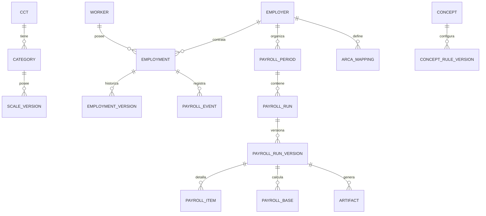

# Modelo de datos propuesto (borrador lógico, no DDL definitivo)

## 1. Principios
- Multiempresa, **sin** modelo de SaaS externo: el estudio administra varios CUIT de clientes en una base de datos común.
- Todas las relaciones de empleado/liquidación están vinculadas a `employer_id`.
- Catálogos que el usuario cree globales pueden necesitar reglas por convenio/empleador; evitar acoplamiento.
- Escalas, configuración, fórmulas y datos laborales historizados; período liquidado almacena **snapshot** de entradas y reglas.
- Auditoría por acción más versiones inmutables; borrado lógico para catálogos, no cascada destructiva de liquidaciones.
- Las fechas de inicio/fin de vigencia deben tener semántica inclusiva/exclusiva documentada (propuesta: inicio inclusivo, fin exclusivo).
- Importes DECIMAL/NUMERIC; códigos fiscales, legajos y abreviaturas como texto.

## 2. Entidades recomendadas

| Tabla/entidad | Campos centrales | Reglas |
|---|---|---|
| `users` | id, login, password_hash, estado, MFA | Nunca contraseñas en claro |
| `roles` / `permissions` / `user_roles` | rol, permiso, empresa opcional | Chequeo servidor |
| `employers` | id, cuit, razón_social, estado | CUIT único y validado |
| `employer_settings_versions` | employer_id, effective_from, version, config_json | Inmutable tras aprobación |
| `workplaces` | employer_id, código, nombre, localidad | Lugar de pago/establecimiento |
| `workers` | id, cuil, datos mínimos | CUIL identificado; protección datos |
| `employments` | id, employer_id, worker_id, legajo, fecha_ingreso, fecha_antiguedad, fecha_egreso | Una persona puede trabajar para varias empresas |
| `employment_versions` | employment_id, effective_from, category_id, jornada, obra_social, modalidad, parámetros | Cambios históricos |
| `ccts` | id, número, nombre, estado | Convenios múltiples |
| `categories` | id, cct_id, código, descripción | Un convenio contiene categorías |
| `scale_versions` | category_id, effective_from, effective_to, monto, regla_jornada, fuente | No sobreescribir período anterior |
| `social_health_providers` | código, nombre, vigencia | Catálogo con códigos de 6 chars |
| `concept_definitions` | id, código_visible, nombre, tipo, unidad | Catálogo común posible |
| `concept_rule_versions` | id, concept_id, cct_id?, employer_id?, vigencia, AST, condiciones, flags | Prioridad controlada; conflictos validados |
| `formula_variable_dictionary` | código, tipo, definición, origen | Confirmado por liquidador |
| `arca_concept_mappings` | employer_id, code_employer, code_arca, flags_previsionales, vigencia, aprobación | Mapeo por empleador |
| `periods` | employer_id, YYYYMM, estado | Una empresa-período |
| `payroll_runs` | employer_id, period_id, tipo, número, fecha_pago, estado | Soporta múltiples liquidaciones/mes |
| `payroll_run_versions` | payroll_run_id, version_num, snapshot, creador, aprobador, estado, motivo | Inmutable cuando cerrada |
| `payroll_items` | run_version_id, employment_id, concept_id, cantidad, unidad, monto, remunerativo, débito/crédito, regla_version | Líneas de recibo, pruebas y auditoría |
| `payroll_bases` | run_version_id, employment_id, base_tipo, monto | Bases ARCA independientes |
| `payroll_events` | employer_id, employment_id, tipo, fecha_ini/fin, unidades, datos, estado | Faltas/licencias/bajas/altas internas |
| `generated_artifacts` | run_version_id, tipo, storage_key, sha256, fecha, usuario, estado_arca | PDF/TXT privados versionados |
| `audit_events` | actor_user_id, employer_id, acción, objeto, before_after_sanitizado, timestamp | Append-only |
| `legacy_import_batches` | origen, fecha, hash, conteos, estado, usuario | Migración rastreable |
| `legacy_import_rows` | batch_id, origen_id, destino_id?, problema | Reconciliación |

## 3. Cardinalidades

## 4. Prioridad de reglas (requiere aprobación)
1. Regla específica de **empresa+convenio**, efectiva para el período.
2. Regla específica de **convenio**, efectiva para el período.
3. Regla común, efectiva para el período.

No aplicar una sobrescritura por empresa sin un indicador visual y sin aprobación. La precedencia es una **propuesta**, no una verdad descubierta en Cortez.

## 5. Invariantes y transacciones
- Un `payroll_item` no puede referirse a relación laboral de otra empresa.
- `payroll_run_version` aprobada no se edita: generar siguiente versión.
- Índice único propuesto `(employer_id, period, type, number)` para liquidación lógica; revisión separada por número de versión.
- `effective_from` no debe solaparse con otra regla activa del mismo ámbito cuando produzca ambigüedad.
- Todo resultado publicado referencia hash del snapshot y las versiones exactas de reglas.
- Alta de corrección, comparación y aprobación ejecutadas con transacciones; concurrencia por `lock_version`.
- Emisión de TXT y PDF debe referir a una versión específica cerrada; toda reemisión registra usuario y hora.
- `worker_id` global permite reuso de CUIL, **pero** autorización siempre se hace sobre `employer_id` de `employment` (no solo `worker_id`).

## 6. Variables y engine
- Tokens posibles observados: `SB`, `VI`, `AN`, `IM`, `TH`, `TS`, `TSI`, `OSO`, `SID`, `SIM`, `SIT`, `NR`, `TD`, `TN`, `CQnnn`, `LQnnn`.
- **No** definir semántica de variables no confirmadas por inferencia del nombre.
- Parsear a AST tipado; sólo admitir suma, resta, multiplicación, división, comparaciones, booleanos, `IIF` si se reproduce su semántica, y funciones explícitas aprobadas.
- Detectar ciclos antes del cálculo. Registrar valores intermedios relevantes en traza de depuración con acceso restringido.
- Precisiones y redondeos (HALF_UP/otros) por confirmar, versionar por regla.
- Fórmulas multipicadas por `*0` observadas en listado de Comercio no se deben «limpiar» automáticamente.

## 7. Posibles estrategias de corrección
- `v1` = cierre original; `v2` = corrección aprobada, con referencia a `v1`.
- Mostrar diff de parámetros, novedades, líneas, remuneraciones y neto.
- Conservar artefactos `PDF(v1)`, `TXT(v1)`, `PDF(v2)`, `TXT(v2)`; invalidar operativamente el uso de la versión antigua sin borrarla.
- Campo `submission_status` separado de `payroll_run_status`: ARCA pendiente/aceptado/rechazado; fecha/observaciones registradas manualmente.
- Distinguir ajuste en período nuevo vs rectificación del período anterior: **decisión contable**, no automatización tácita.
